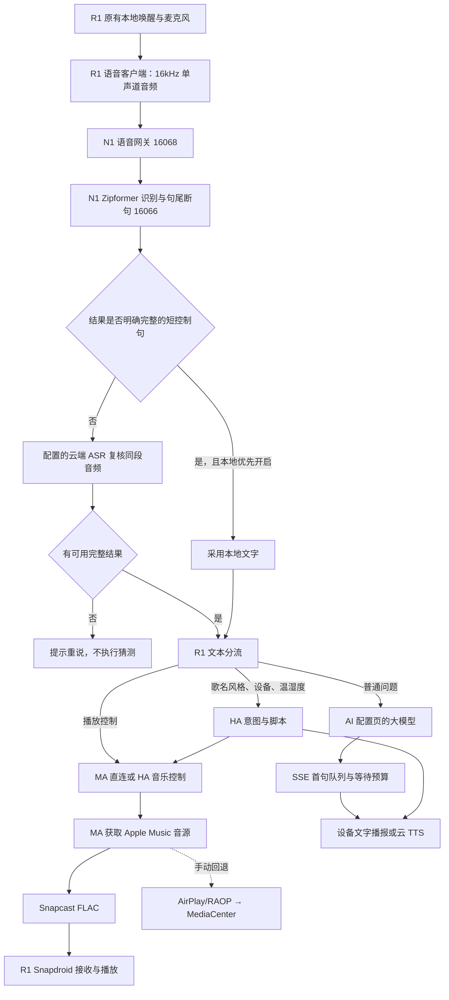

# 架构与数据流

ASR 云端请求由 **N1 网关**发送，HA 不负责转发麦克风录音。R1 负责采集、唤醒和执行分流；本地识别服务负责小模型识别和断句；N1 网关负责云端复核与快捷音乐控制。

云端复核上传的是该轮音频，不能只把本地已经识别错的文字交给云端“纠正”来替代声音转写。本地明确短指令不需要云端识别调用。

HA 用于家居实体与规则；MA 用于音乐库、音源授权、队列和播放协议。两者的访问令牌不同。AI 聊天模型用来回答普通问题，不能直接替代音频转写模型。

原生云知声识别/问答回调已经被关闭；失败时不会回到“还在成长中”等回答。设备自带 TTS 仍可作为文字播报能力使用。

音乐播放和语音播报是两条音频路径。R1 的 Snapcast 接收端在 `de.badaix.snapcast`，AirPlay 回退端在 `com.droidlogic.mediacenter`，语音客户端在 `com.phicomm.speaker.device`。网页中的逻辑播放器名称、MA 状态更新与人耳听见新曲的时间不相同。
